# Mission 2 — Python 객체지향 퀴즈 게임

> AI 올인원 과정 · Mission 2 수행 보고서  
> **프로젝트:** Python 콘솔 퀴즈 게임  
> **제출 저장소:** `https://github.com/<GitHub-사용자명>/<저장소명>` *(실제 주소로 교체)*  
> **검증 상태:** 아래 실행 화면과 Git 증거는 `evidence/`에 실제 캡처 파일을 추가한 후 최종 확인한다.

## 1. 프로젝트 개요

Python 기본 문법과 객체지향 프로그래밍을 활용하여 터미널에서 실행되는 4지선다 퀴즈 게임을 개발한다. 사용자는 메뉴를 통해 퀴즈를 풀고, 문제를 추가하고, 목록과 최고 점수를 확인할 수 있다. `state.json`에 퀴즈와 최고 점수를 저장하여 프로그램을 종료한 뒤에도 데이터를 유지한다. Git으로 기능별 변경 이력을 관리하고 브랜치 생성·병합 및 GitHub Clone·Pull 과정을 검증한다.

### 1.1 퀴즈 주제와 선정 이유

**주제: Python 기초 문법 및 프로그래밍 개념**

Python의 자료형, 조건문, 반복문, 클래스 등 학습한 개념을 직접 문제로 만들어 복습하기 위해 선정하였다. 프로그램을 구현하면서 사용한 문법을 퀴즈로 다시 확인할 수 있어 학습과 검증을 연결할 수 있다.

### 1.2 달성 기준

| 구분 | 요구사항 | 검증 방법 |
|---|---|---|
| 프로그램 | 메뉴, 풀기, 추가, 목록, 최고 점수, 종료 | 기능별 실행 화면 |
| 기본 데이터 | 4지선다 퀴즈 5개 이상 | 초기 목록 및 `state.json` 확인 |
| 객체지향 | `Quiz`, `QuizGame` 등 2개 이상 클래스 | 소스코드 확인 |
| 데이터 저장 | 루트 `state.json`, UTF-8, 재실행 후 유지 | 재실행 전후 비교 |
| 예외 처리 | 빈 값, 문자, 범위 초과, Ctrl+C, EOF, 손상 파일 | 예외 입력 테스트 |
| Git | 의미 있는 커밋 10개 이상, 브랜치 생성 및 병합 | Git 로그와 브랜치 그래프 |
| 동기화 | `init`, `add`, `commit`, `push`, `pull`, `checkout`, `clone` | 명령 실행 기록 |

## 2. 개발 환경

| 항목 | 환경 또는 기준 |
|---|---|
| 운영체제 | Windows / PowerShell |
| 편집기 | Visual Studio Code |
| Python | 3.10 이상 필요 — 실제 버전은 실행 화면으로 확인 |
| Git | Git for Windows — 실제 버전은 실행 화면으로 확인 |
| 외부 패키지 | 사용하지 않음 (Python 표준 라이브러리만 사용) |
| 데이터 형식 | JSON / UTF-8 |

개발환경 점검 명령:

```powershell
python --version
py --version
git --version
git config --global --list
Get-Location
```

> `python --version`이 버전 대신 `Python`만 출력된다면 `py --version` 또는 Python 실행 경로를 점검한다. Python 3.10 이상 설치 여부를 실제로 확인해야 한다. Git 설정 캡처에서는 이메일 주소 등 개인정보를 가린다.

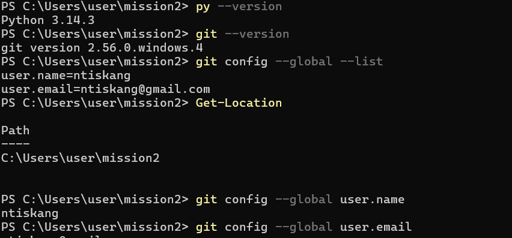

## 3. 프로젝트 파일 구조

```text
mission2/
├── main.py                 # Quiz, QuizGame 및 실행 진입점
├── state.json              # 퀴즈 목록 및 최고 점수 저장
├── .gitignore              # Git 추적 제외 규칙
├── README.md               # 미션 수행 및 검증 보고서
└── evidence/               # 실행 결과 및 Git 작업 증거
    ├── 01-development-environment.png
    ├── ...
    ├── 19-github-repository.png
    └── 20~24-bonus-*.png  # 보너스 기능 검증 화면
```

`state.json`은 실행 과정에서 생성되거나 갱신될 수 있다. `evidence/` 이미지와 `README.md`는 GitHub에 함께 올려야 GitHub에서도 그림이 표시된다.

## 4. 실행 방법

PowerShell에서 프로젝트 디렉터리로 이동한 뒤 실행한다.

```powershell
cd C:\Users\user\mission2
python main.py
```

Python 실행 명령이 정상 작동하지 않으면 설치 상태를 확인한 뒤 다음 명령을 시도한다.

```powershell
py main.py
```

프로그램은 메뉴 번호를 입력받아 해당 기능을 실행하며, 종료 메뉴를 선택하면 저장 가능한 데이터를 저장하고 종료하도록 설계한다.

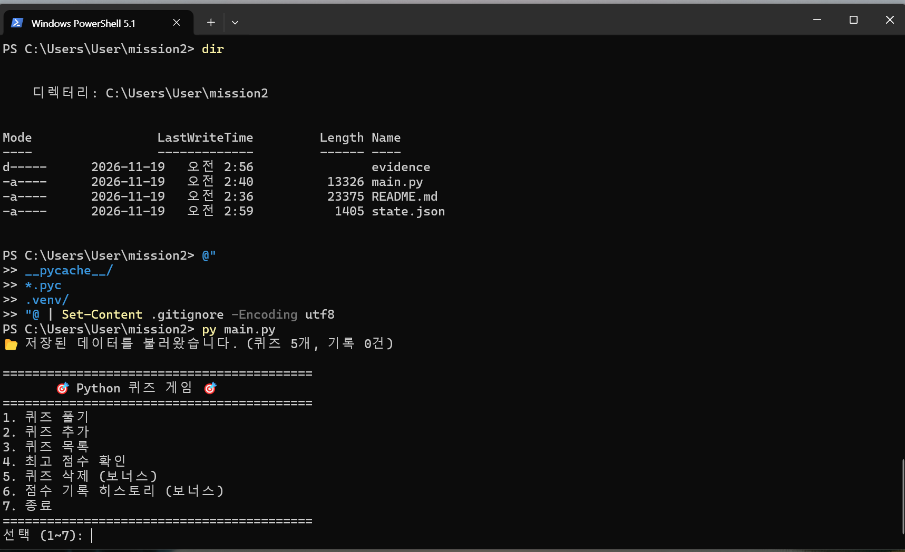

## 5. 객체지향 설계

### 5.1 `Quiz` 클래스 — 개별 문제 관리

| 구성요소 | 역할 |
|---|---|
| `question` | 문제 문장 저장 (`str`) |
| `choices` | 선택지 4개 저장 (`list`) |
| `answer` | 정답 번호 1~4 저장 (`int`) |
| `__init__()` | 새 객체의 속성 초기화 |
| `display()` | 문제 및 선택지 출력 |
| `check_answer(user_answer)` | 정답 여부를 `bool`로 반환 |
| `to_dict()` | JSON 저장용 딕셔너리로 변환 |

### 5.2 `QuizGame` 클래스 — 전체 진행 관리

| 구성요소 | 역할 |
|---|---|
| `quizzes` | 등록된 `Quiz` 객체 목록 |
| `best_score` | 최고 점수 또는 최고 정답 수 저장 |
| 메뉴 처리 | 사용자 선택에 따라 기능 호출 |
| 퀴즈 진행 | 문제 출력, 답안 입력, 정답 판정 및 결과 계산 |
| 퀴즈 추가·목록 | 등록, 조회 및 데이터 갱신 |
| 점수 확인 | 최고 점수 조회 및 필요 시 갱신 |
| `load_data()` | `state.json`에서 데이터 불러오기 |
| 저장 메서드 | 현재 데이터를 `state.json`에 기록 |

**설계 이유:** 문제 한 개의 정보와 동작은 `Quiz`에, 여러 문제와 게임 흐름은 `QuizGame`에 맡겨 역할을 분리하였다. `self`는 해당 객체의 속성과 메서드에 접근하기 위해 사용한다.

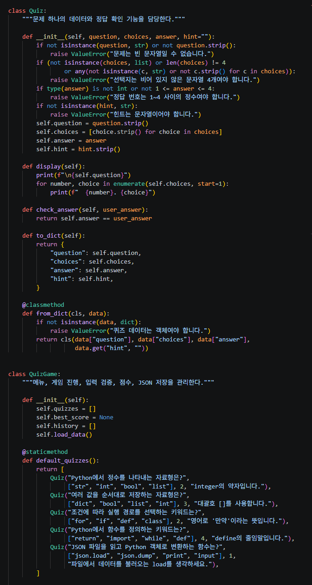

## 6. 기능 구현 및 실행 검증

### 6.1 메뉴 선택 및 종료

메뉴에서 퀴즈 풀기, 퀴즈 추가, 퀴즈 목록, 점수 확인, 종료 기능을 선택한다. `while` 반복문을 이용하면 종료를 선택하기 전까지 메뉴를 반복해서 표시할 수 있다. `if/elif/else`로 선택한 기능을 분기한다.

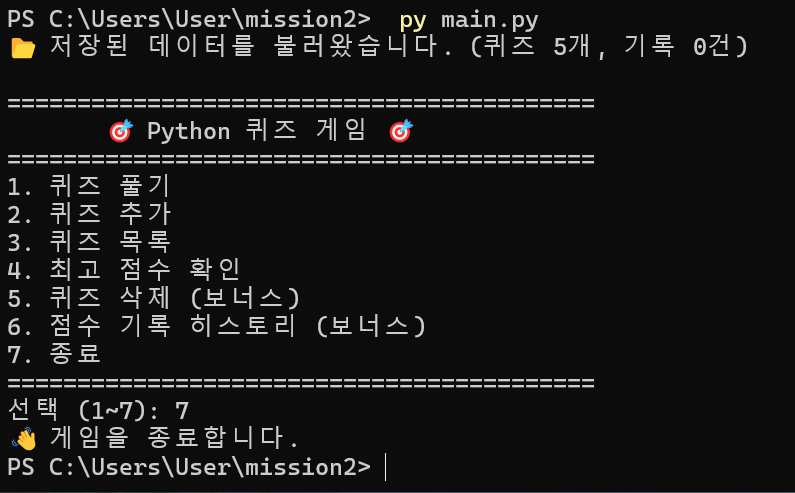

### 6.2 기본 퀴즈 5개 이상

Python 기본 개념을 다루는 4지선다 문제를 초기 데이터로 구성한다. 예를 들어 `int`, `list`, `dict`, 조건문, 클래스 관련 문제를 포함할 수 있다. **실제 제출 시 소스코드의 기본 문제 개수와 선택지·정답이 요구사항을 충족하는지 확인한다.**

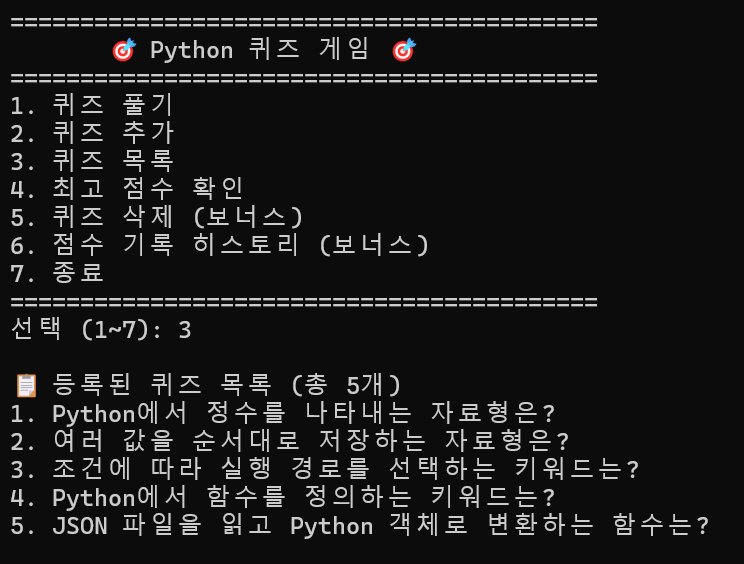

### 6.3 퀴즈 풀기

1. 등록된 문제를 순서대로 출력한다.
2. 사용자에게 1~4 중 정답 번호를 입력받는다.
3. 정답 여부를 판정하고 정답 수를 누적한다.
4. 모든 문제를 마치면 총 문제 수와 점수를 표시한다.
5. 이전 최고 점수보다 높으면 갱신하고 저장한다.
6. 등록된 퀴즈가 없다면 안내 메시지를 표시한다.

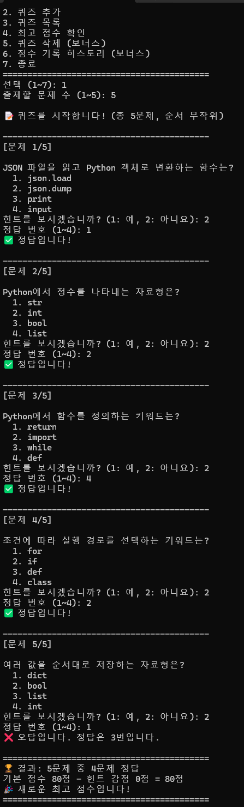

### 6.4 퀴즈 추가

문제 문장, 선택지 4개, 정답 번호를 입력받아 `Quiz` 객체를 만들고 목록에 추가한다. 정답 번호는 1~4 범위로 제한하며 빈 입력이나 잘못된 숫자는 다시 입력하도록 처리한다. 추가 직후 JSON 파일에 저장한다.

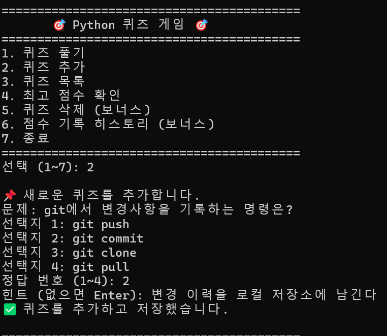

### 6.5 퀴즈 목록

등록된 문제를 번호와 함께 출력한다. 문제 수가 0개이면 등록된 퀴즈가 없다는 안내를 표시한다.

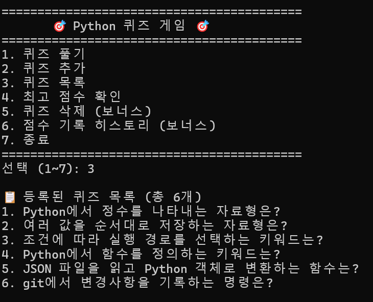

### 6.6 최고 점수

게임 종료 시 현재 점수를 이전 최고 점수와 비교한다. 더 높은 점수라면 최고 기록을 갱신하고 `state.json`에 저장한다. 아직 기록이 없을 때는 기록 없음 메시지를 표시한다.

> 최고 점수를 **정답 개수**로 저장하는지 **100점 환산 점수**로 저장하는지는 실제 코드에 맞춰 일관되게 표기한다. 문제 수가 달라지는 기능을 추가할 경우 비교 기준도 명확히 정한다.

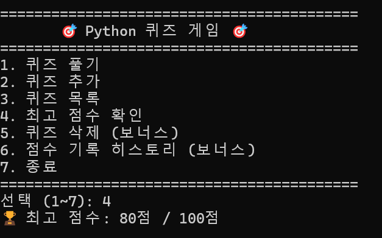

## 7. 입력 검증 및 예외 처리

| 테스트 | 입력·상황 | 기대 결과 |
|---|---|---|
| T01 | 메뉴 ` 1 ` | 공백 제거 후 1번 기능 실행 |
| T02 | 메뉴 `abc` | 숫자 입력 안내 후 재입력 |
| T03 | 메뉴 `9` | 허용 범위 안내 후 재입력 |
| T04 | 메뉴에서 Enter | 빈 입력 안내 후 재입력 |
| T05 | 정답 `0` 또는 `5` | 1~4 범위 안내 후 재입력 |
| T06 | 문제/선택지 빈 입력 | 등록 거부 및 재입력 |
| T07 | 실행 중 Ctrl+C | 안내 후 가능한 데이터 저장 및 안전 종료 |
| T08 | EOFError | 안내 후 가능한 데이터 저장 및 안전 종료 |
| T09 | `state.json` 없음 | 기본 퀴즈로 실행 |
| T10 | `state.json` 손상 | 오류 안내 후 기본 데이터로 복구 또는 초기화 |
| T11 | JSON 읽기·쓰기 실패 | 예외 처리 및 사용자 안내 |
| T12 | 퀴즈 목록이 비어 있음 | 풀이·목록에서 안내 표시 |

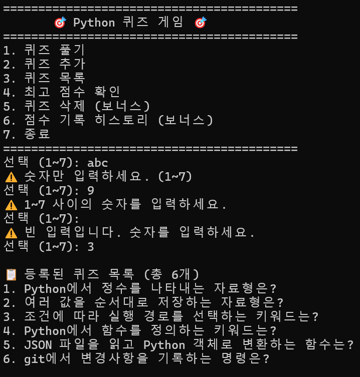

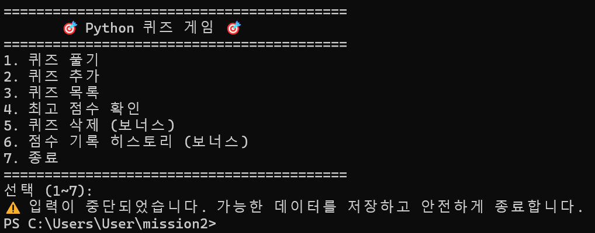

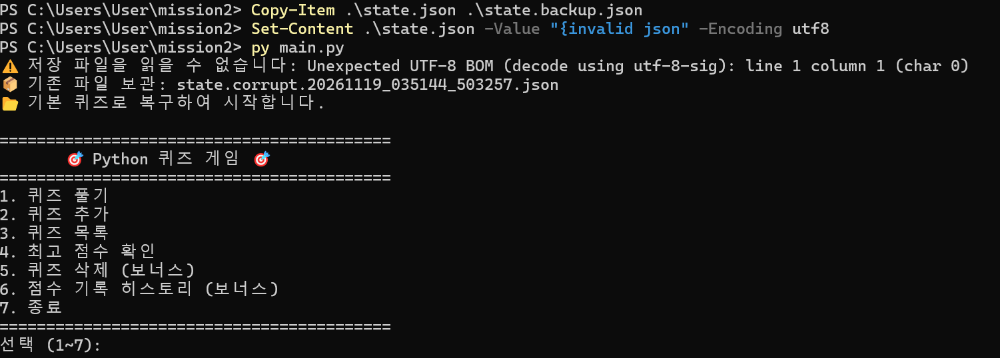

## 8. JSON 데이터 저장과 영속성

### 8.1 저장 파일

- **경로:** 프로젝트 루트의 `state.json`
- **형식:** JSON
- **인코딩:** UTF-8
- **저장 대상:** 등록된 퀴즈 목록과 최고 점수
- **첫 실행:** 파일이 없으면 기본 퀴즈를 사용
- **재실행:** 파일이 있으면 저장된 데이터를 읽어 객체와 점수를 복원

스키마 예시(실제 저장 파일의 값과 다를 수 있음):

```json
{
  "quizzes": [
    {
      "question": "Python에서 정수를 나타내는 자료형은?",
      "choices": ["str", "int", "bool", "list"],
      "answer": 2
    }
  ],
  "best_score": 4
}
```

| 키 | 자료형 | 의미 |
|---|---|---|
| `quizzes` | `list` | 퀴즈 객체의 JSON 표현 목록 |
| `question` | `str` | 문제 문장 |
| `choices` | `list[str]` | 4개 선택지 |
| `answer` | `int` | 1~4 중 정답 번호 |
| `best_score` | `int` 또는 `null` | 최고 기록; 미플레이 시 `null` 가능 |

### 8.2 영속성 검증 절차

1. 프로그램 실행 후 새 퀴즈 1개를 추가한다.
2. 퀴즈를 풀고 최고 점수를 생성한다.
3. 프로그램을 정상 종료한다.
4. `state.json`에 추가 문제와 최고 점수가 기록되었는지 확인한다.
5. 프로그램을 다시 실행한다.
6. 퀴즈 목록과 최고 점수가 종료 전과 동일한지 비교한다.

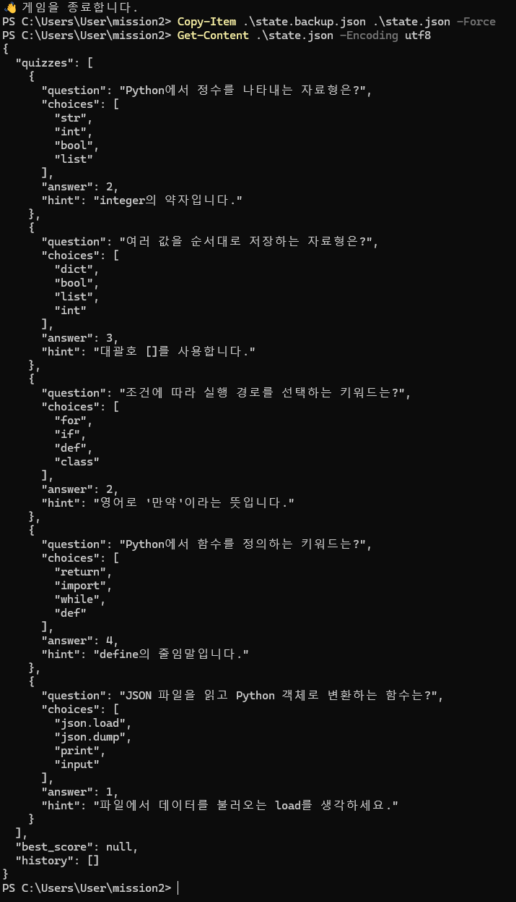

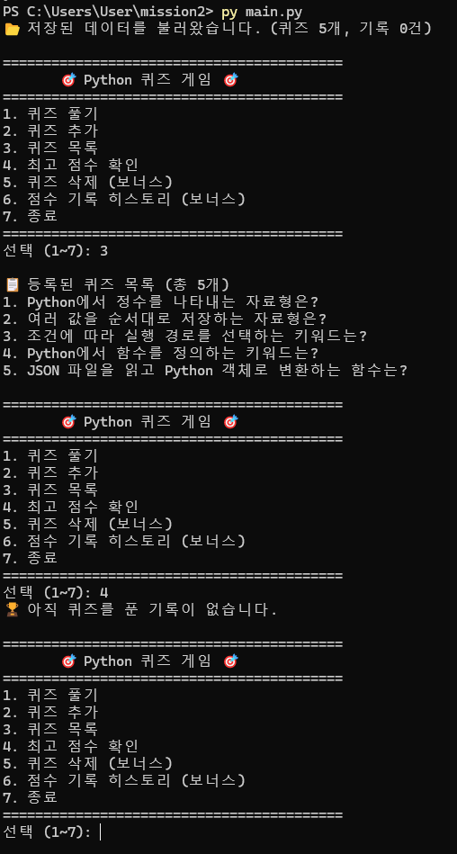

## 9. Git 및 GitHub 버전관리

### 9.1 저장소 초기화 및 최초 업로드

```powershell
git init
git status
git add .gitignore README.md main.py
git commit -m "Chore: Initialize Python quiz game repository"
git branch -M main
git remote add origin https://github.com/<GitHub-사용자명>/<저장소명>.git
git push -u origin main
```

> 위 URL은 예시다. 이미 `origin`이 등록된 저장소에서는 `git remote add origin`을 다시 실행하지 말고 `git remote -v`로 확인한다. 첫 커밋 시점에 아직 존재하지 않는 파일은 `git add` 대상에서 제외한다.

### 9.2 기능 단위 커밋 계획

아래는 **권장 커밋 이력 예시**이며 실제로 존재하는 커밋 목록이 아니다. 최종 제출에서는 `git log`로 확인한 실제 이력으로 검증한다.

| 순서 | 권장 커밋 메시지 | 변경 내용 |
|---|---|---|
| 1 | `Chore: Initialize quiz game repository` | 저장소 초기화 |
| 2 | `Feat: Add console menu and exit` | 메뉴·종료 |
| 3 | `Feat: Implement Quiz class` | 문제 객체 |
| 4 | `Feat: Add five default quizzes` | 초기 문제 |
| 5 | `Feat: Implement quiz play flow` | 풀이·채점 |
| 6 | `Feat: Add quiz registration` | 문제 추가 |
| 7 | `Feat: Display quiz list` | 목록 조회 |
| 8 | `Feat: Track best score` | 최고 점수 |
| 9 | `Feat: Save and load JSON state` | 영속성 |
| 10 | `Fix: Handle invalid input and file errors` | 예외 처리 |
| 11 | `Refactor: Separate QuizGame responsibilities` | 클래스 구조 정리 |
| 12 | `Docs: Add README and evidence` | 문서·증거 |

실제 커밋 수 확인:

```powershell
git log --oneline --graph --decorate --all
git rev-list --count HEAD
git status
```

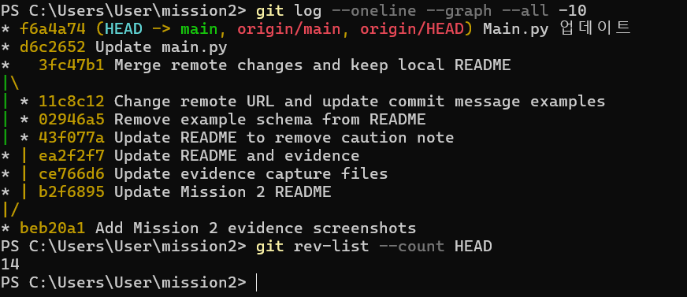

### 9.3 기능 브랜치 생성 및 병합

퀴즈 풀이 기능을 별도 브랜치에서 구현하는 예시:

```powershell
git checkout main
git checkout -b feature/quiz-play
# main.py에서 퀴즈 풀이 기능 구현 및 테스트
git add main.py
git commit -m "Feat: Implement quiz play flow"
git checkout main
git merge --no-ff feature/quiz-play -m "Merge feature/quiz-play into main"
git push origin main
git log --oneline --graph --decorate --all
```

`--no-ff`는 가능할 때 별도 병합 커밋을 만들어 브랜치 작업 이력을 그래프에서 확인하기 쉽게 한다. 실제 브랜치와 병합 기록이 있어야 이 요구사항을 달성한 것으로 판정한다.

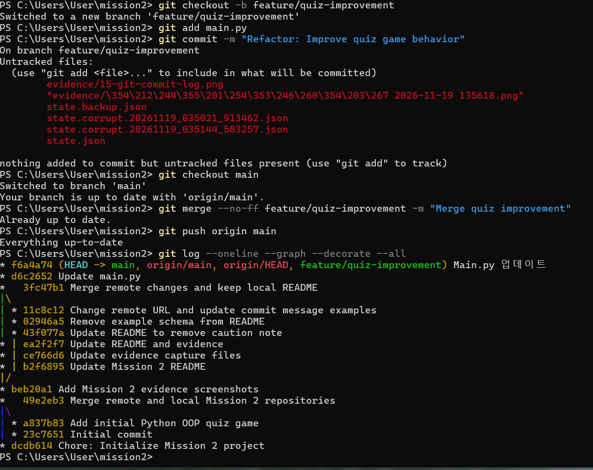

### 9.4 Clone 및 Pull 검증

개발이 완료된 후 **기존 작업 디렉터리와 다른 폴더**에 복제한다.

```powershell
cd C:\Users\강신철위원
git clone https://github.com/<GitHub-사용자명>/<저장소명>.git quiz-game-clone
cd .\quiz-game-clone
Add-Content README.md "`nClone repository verification completed."
git add README.md
git commit -m "Docs: Verify clone workflow"
git push origin main
```

이후 기존 작업 디렉터리에서 변경사항을 받아 확인한다.

```powershell
cd C:\Users\user\mission2
git status
git pull origin main
git log -1 --oneline
Select-String -Path README.md -Pattern "Clone repository verification completed"
```

`git pull` 전 기존 작업 디렉터리에 미커밋 변경사항이 없는지 확인한다. 복제 폴더에서 푸시한 문구가 기존 폴더의 README에도 나타나면 동기화를 확인할 수 있다.

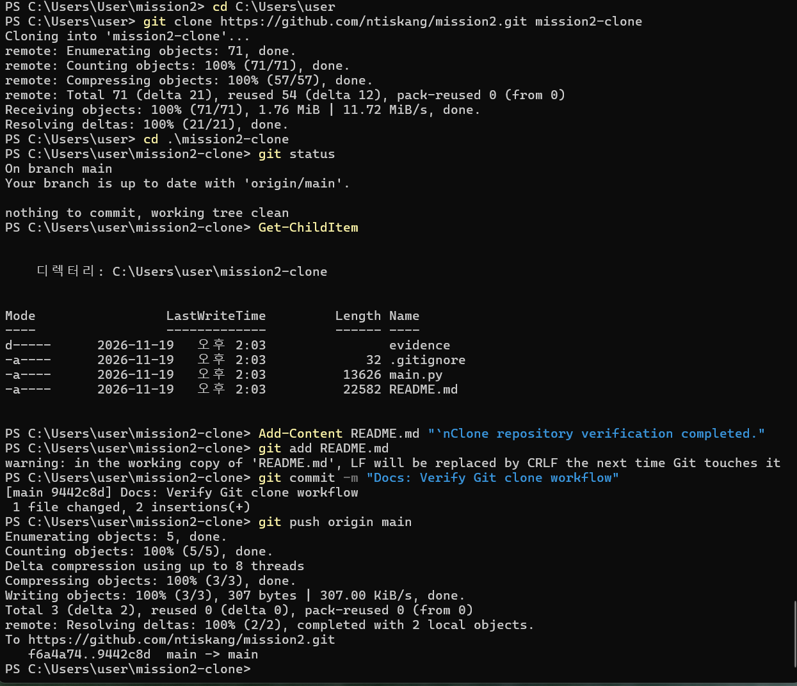

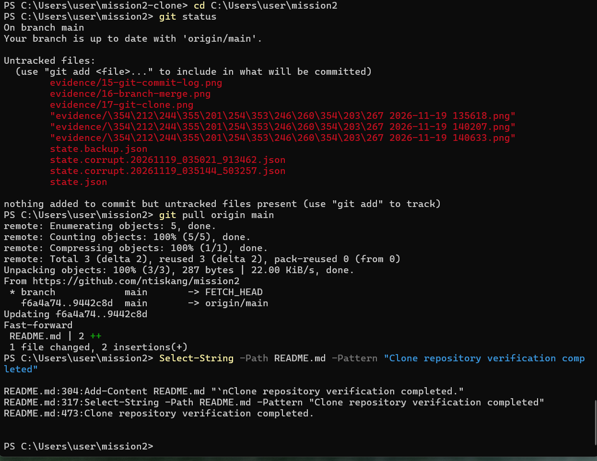

### 9.5 GitHub 최종 제출 확인

```powershell
git status
git remote -v
git push origin main
```

GitHub 웹페이지에서 `main.py`, `README.md`, `.gitignore`, `evidence/`와 실제 커밋 기록을 확인한다. `state.json`은 프로젝트 저장 정책에 따라 추적 여부를 결정하되, 데이터 영속성 검증 증거는 반드시 남긴다.

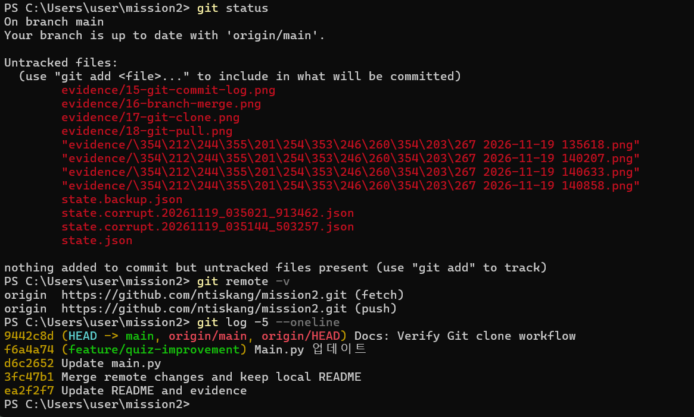

## 10. 핵심 기술 학습 정리

| 개념 | 본 과제 적용 |
|---|---|
| 변수 | 메뉴 선택값, 사용자 정답, 현재 점수 저장 |
| `int` / `str` / `bool` | 정답 번호 / 문제 문장 / 정답 판정 |
| `list` / `dict` | 문제 목록 / JSON 저장용 키-값 데이터 |
| `if/elif/else` | 메뉴 분기, 정답 판정, 점수 갱신 |
| `for` | 선택지 및 문제 목록 순회 |
| `while` | 메뉴 반복 및 재입력 |
| 함수·매개변수·반환값 | 입력을 받아 정답 여부를 반환 |
| 클래스·객체 | `Quiz`와 `QuizGame`의 역할 분리 |
| `__init__` / `self` | 객체 생성 시 속성 초기화 / 인스턴스 참조 |
| `try/except` | 숫자 변환, JSON 처리, 종료 예외 대응 |
| `json.load` / `json.dump` | 저장 데이터 읽기 / 쓰기 |
| Git | 변경 추적, 기능 단위 커밋, 브랜치 병합 |
| GitHub | 원격 백업, Clone 및 Pull 동기화 |

## 11. 최종 제출 체크리스트

실제 확인을 마친 항목에만 체크한다.

- [ ] Python 3.10 이상에서 정상 실행
- [ ] 기본 퀴즈 5개 이상 및 4개 선택지 확인
- [ ] `Quiz`, `QuizGame` 클래스와 기능별 메서드 확인
- [ ] 메뉴·풀기·추가·목록·점수·종료 테스트
- [ ] 잘못된 입력 및 중단 예외 테스트
- [ ] JSON 파일 누락·손상·읽기·쓰기 오류 처리 확인
- [ ] 프로그램 재시작 후 퀴즈와 최고 점수 유지
- [ ] 의미 있는 커밋 10개 이상 확인
- [ ] 브랜치 생성 및 병합 이력 확인
- [ ] Git 7개 명령어 사용 기록 확인
- [ ] Clone → 수정 → Commit → Push → 기존 폴더 Pull 검증
- [ ] GitHub 저장소 URL 및 `evidence/` 이미지 링크 확인
- [ ] 보너스 과제 5개 전부 구현 및 테스트 완료

## 12. 증거자료 파일 목록

아래 표의 파일명은 **캡처 저장 규칙**이다. 파일이 실제로 존재해야 GitHub README에서 이미지가 표시된다.

| 번호 | 파일명 (`evidence/` 기준) | 증거자료 설명 |
|---|---|---|
| 01 | `01-development-environment.png` | VS Code, Python·Git 버전 및 개발환경 확인 |
| 02 | `02-main-menu.png` | 프로그램 최초 실행 및 메인 메뉴 |
| 03 | `03-class-structure.png` | `Quiz`, `QuizGame` 클래스 및 주요 메서드 |
| 04 | `04-menu-exit.png` | 메뉴 선택과 정상 종료 동작 |
| 05 | `05-default-quizzes.png` | 기본 퀴즈 5개 이상과 4지선다 구조 |
| 06 | `06-quiz-play.png` | 문제 출제, 정답 판정, 결과 출력 |
| 07 | `07-add-quiz.png` | 신규 문제·선택지·정답 등록 |
| 08 | `08-quiz-list.png` | 등록된 퀴즈 목록 조회 |
| 09 | `09-best-score.png` | 최고 점수 조회 및 갱신 |
| 10 | `10-invalid-input.png` | 문자·공백·빈 입력·범위 초과 처리 |
| 11 | `11-interrupt-eof.png` | Ctrl+C와 EOF 안전 종료 처리 |
| 12 | `12-corrupt-json.png` | 손상된 JSON 복구·초기화 메시지 |
| 13 | `13-state-json.png` | JSON 파일의 실제 저장 구조와 값 |
| 14 | `14-persistence-restart.png` | 재실행 후 추가 퀴즈·최고 점수 유지 |
| 15 | `15-git-commit-log.png` | `git log --oneline --graph --decorate --all` 및 커밋 수 |
| 16 | `16-branch-merge.png` | 기능 브랜치 생성과 `main` 병합 기록 |
| 17 | `17-git-clone.png` | 별도 폴더로 원격 저장소 복제 |
| 18 | `18-git-pull.png` | 기존 폴더에서 Pull 및 변경 반영 확인 |
| 19 | `19-github-repository.png` | GitHub 파일 목록, 브랜치 및 최종 업로드 |
| 20 | `20-bonus-random.png` | 랜덤 출제 순서 비교 및 중복 없는 출제 |
| 21 | `21-bonus-question-count.png` | 문제 수 선택과 범위·문자 입력 검증 |
| 22 | `22-bonus-hint.png` | 힌트 표시 및 힌트 사용 시 점수 차감 |
| 23 | `23-bonus-delete.png` | 퀴즈 삭제와 재실행 후 삭제 유지 |
| 24 | `24-bonus-history.png` | 날짜·시간별 게임 기록 및 재실행 후 조회 |

---

**최종 제출 시 유의사항:** 위 증거 이미지는 현재 실제 파일이 아니라 링크 경로만 지정한 상태다. 각 화면을 캡처하여 `evidence/` 폴더에 동일한 이름으로 저장하고 `git add README.md evidence/` → `git commit` → `git push`를 수행한다. 실행하지 않은 테스트나 존재하지 않는 Git 기록은 완료로 표시하지 않는다.

---

## 13. 보너스 과제 — 5개 항목 모두 수행 대상으로 선정

**선택 결과:** 제시된 보너스 과제 5개를 모두 구현·검증 대상으로 채택한다. 아래는 구현 기준과 검증 계획이다. 실제 코드 실행 및 증거 확보 전에는 완료로 표시하지 않는다.

### 13.1 랜덤 출제

- `random.shuffle()`로 퀴즈 순서를 매 게임마다 섞는다. 원본 목록을 보존하려면 `random.sample(self.quizzes, k=len(self.quizzes))`로 복사된 순서를 사용한다.
- 한 게임에서 같은 문제가 중복 출제되지 않도록 한다.
- **검증:** 같은 퀴즈 집합으로 여러 번 실행해 순서를 비교하고, 문제 중복 여부를 확인한다.

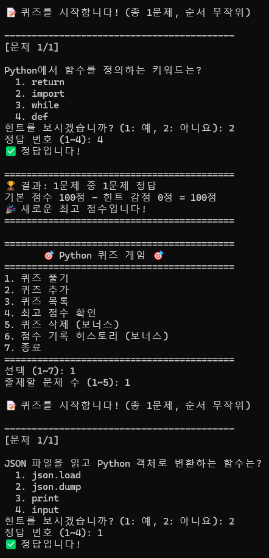

### 13.2 풀이 문제 수 선택

- 시작 전에 문제 수를 입력받고, **1개부터 현재 등록된 퀴즈 수까지** 허용한다.
- 공백 제거 후 정수로 변환하며, 빈 입력·문자·0·전체 문제 수 초과 입력 시 안내 후 재입력한다.
- 선택한 문제 수만 랜덤 출제하고, 결과 점수는 해당 게임의 문제 수를 기준으로 계산한다.
- **검증:** 정상 선택 및 범위 초과·문자·빈 입력을 시험한다.

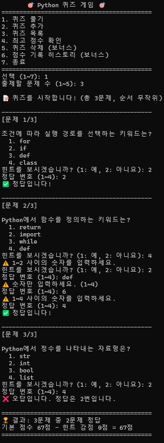

### 13.3 힌트 기능과 점수 차감

- `Quiz`에 `hint` 속성을 추가한다. 기존 퀴즈 데이터와 호환되도록 힌트가 없는 경우 빈 문자열을 기본값으로 사용한다.
- 문제를 푸는 동안 힌트 요청 기능을 제공한다. 힌트가 없는 문제는 별도 메시지로 알린다.
- **점수 정책:** 정답은 기본 20점, 힌트를 사용한 정답은 10점, 오답은 0점으로 처리한다. 힌트를 여러 번 보더라도 해당 문제의 감점은 한 번만 적용한다.
- 최고 점수는 **100점 만점 환산 점수**로 비교한다. `획득 점수 / (출제 문제 수 × 20) × 100`으로 계산하고, 소수점 처리 규칙을 코드와 README에 일치시킨다.
- **검증:** 힌트 미사용 정답, 힌트 사용 정답, 오답, 힌트 중복 요청을 비교한다.

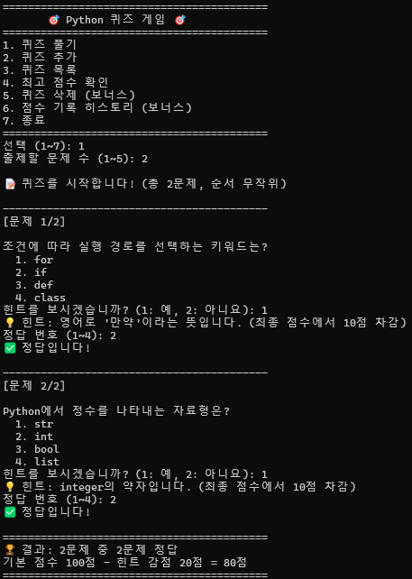

### 13.4 퀴즈 삭제

- 목록에서 삭제할 문제 번호를 입력받고, 삭제 전 문제 내용을 확인할 수 있도록 한다.
- 유효한 번호인지 검사하고, 삭제 확인을 받은 후 목록에서 제거하여 `state.json`에 즉시 반영한다.
- 전체 문제를 삭제한 경우에도 목록 조회와 퀴즈 풀기에서 오류가 발생하지 않도록 한다.
- **검증:** 문제 삭제 전후 목록을 비교하고, 재실행 후에도 삭제 상태가 유지되는지 확인한다.

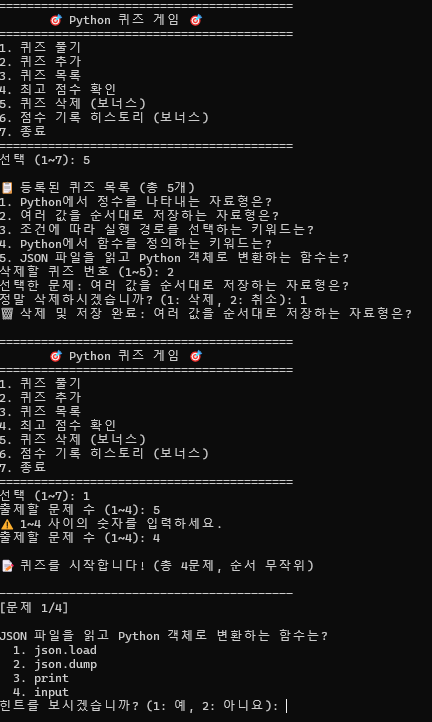

### 13.5 점수 기록 히스토리

- `datetime` 표준 라이브러리로 게임 종료 시각을 기록한다.
- `state.json`에 `history` 배열을 추가하고, 게임마다 `played_at`, `total_questions`, `correct_answers`, `score`, `hints_used`를 저장한다.
- 기존 파일에 `history`가 없어도 빈 배열로 읽어 하위 호환성을 유지한다.
- 별도 메뉴 또는 점수 확인 화면에서 최근 게임 기록을 날짜·시간 순서로 조회한다.
- **검증:** 여러 차례 플레이한 뒤 기록이 누적되고, 프로그램을 종료했다 다시 실행해도 유지되는지 확인한다.

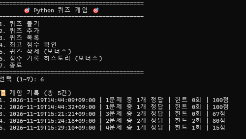

### 13.6 보너스 기능 통합 검증 체크리스트

- [ ] 랜덤 출제: 순서 변경 및 중복 없음 확인
- [ ] 문제 수 선택: 정상·잘못된 입력 처리 확인
- [ ] 힌트: 표시·감점·반복 요청 정책 확인
- [ ] 삭제: 삭제 전 확인 및 JSON 저장·재실행 유지 확인
- [ ] 히스토리: 날짜·시간·점수 저장 및 재조회 확인
- [ ] 기본 기능과 보너스 기능을 함께 사용해 회귀 테스트 완료
- [ ] 보너스 기능별 커밋과 `evidence/20~24-*.png` 캡처 확보

> **주의:** 이 장은 보너스 5개를 모두 선택한 구현·검증 계획이다. 실제 완료 판정은 `main.py`, `state.json`, 실행 결과 및 Git 커밋으로 확인한다.
